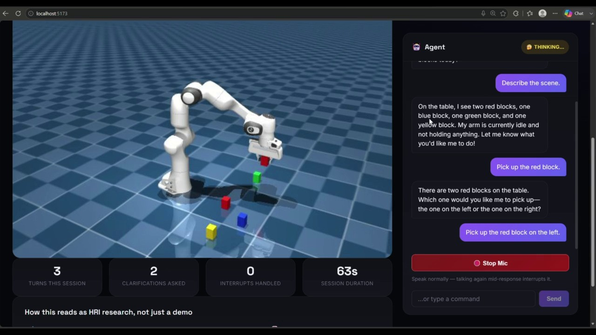
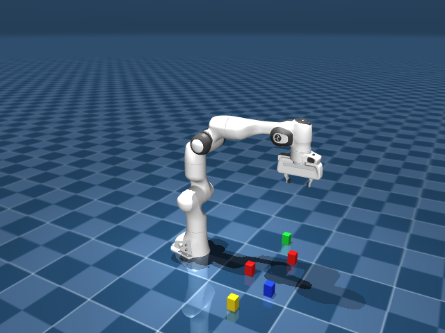
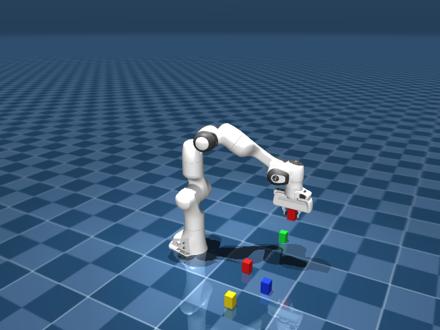

# Voice-Directed Collaborative Assembly Assistant

A voice-controlled robot arm (a simulated Franka Panda in MuJoCo) driven by a LangGraph LLM agent. Speak a command, watch the arm pick up and place colored blocks, and hear a spoken reply. It streams in real time, detects speech automatically (no push-to-talk), and lets you interrupt the arm and the agent mid-sentence (barge-in).

The system is designed around three Human-Robot Interaction problems:

- **Grounding.** There are two red blocks. "Pick up the red block" gets a clarifying question; "the red one on the left" gets acted on directly.
- **Transparency.** "What are you doing?" is answered from the live simulation state, even mid-motion.
- **Mixed-initiative safety.** Talking over the robot halts the arm and cuts its audio within about 120 ms of speech onset.

### Demo (2 min)

[](docs/demo.mp4)

*Click the image to watch the demo (spoken commands throughout). The agent describes the scene and asks which red block is meant when there are two. It picks up the one on the left, reports its state from the live simulation, places the block on the right, and stops the arm on request.*

| The scene: five blocks, two of them red | Mid-task, holding a red block |
|---|---|
|  |  |

## Results

Measured with the scripts in `scripts/eval_*.py`. Raw per-trial data is in [`results/`](results/). The LLM for these runs was Qwen2.5-7B-Instruct (Q4_K_M) served locally through Ollama; Whisper and VAD ran on an NVIDIA RTX 3060.

**Interruption and safety**

| Metric | Result | Trials |
|---|---|---|
| Barge-in latency: speech onset → `barge_in` event at the client, arm already stopped (end to end over WebSocket, incl. VAD) | median **121 ms** (IQR 115–128) | 30 |
| Controller halt latency (`stop()` → motion returns) | mean **9.9 ms** | 50 |
| Arm drift after a halt, before → after the re-target fix | mean **39.5 mm → 8.3 mm** | 50 |

**Grounding and task execution**

| Metric | Result | Trials |
|---|---|---|
| Ambiguity detection recall ("pick up the red block" → asks which) | **100%** (32/32) | 32 |
| Clarification precision | **78%** (32/41) | 64 |
| Unnecessary clarification on unambiguous commands | 28% (9/32) | 32 |
| Same-utterance disambiguation ("the red one on the left") | **81%** acted correctly; when it acted, the correct side 26/26 times | 32 |
| Random pick-and-place task success | **95%** (57/60), 0 malformed tool calls | 60 |

**Pipeline latency (medians)**

| Stage | Result |
|---|---|
| VAD speech-start detection | 111 ms |
| Whisper `small` STT, GPU vs. CPU | 208 ms vs. 2,062 ms |
| LLM, time to first sentence (streamed) vs. full response | 2.24 s vs. 5.41 s |
| Piper TTS, first audio chunk | 103 ms |

The 28% unnecessary-clarification rate is the clearest weakness. The model sometimes claims there are several blocks of a color when there is only one. Halting on speech onset rather than on the LLM's reading of the words is deliberate: when asked to stop, the LLM chose to call `stop_arm` for only 8 of 30 stop phrasings under the default prompt, and 29 of 30 with an explicit stop rule. Either way it takes over a second to decide.

## Architecture

```
Browser (React)                    Backend (FastAPI, /ws)
┌─────────────────┐                ┌──────────────────────────────────┐
│ mic → AudioWorklet│──PCM16 audio──▶│ ws_session.py                     │
│ (16kHz)          │                │  Silero VAD → utterance detection │
│                  │◀─status/audio──│  → stt.py (Whisper, GPU)          │
│ chat UI          │                │  → voice_agent.py (LangGraph)     │
│ live sim view    │◀──MJPEG────────│     → robot_tools.py               │
└─────────────────┘                │        → sim_controller.py         │
                                    │           → MuJoCo (Panda + blocks)│
                                    │  → tts.py (Piper) — streamed       │
                                    │     per sentence back to client    │
                                    └──────────────────────────────────┘
```

[`explanation.md`](explanation.md) covers the design decisions in depth, including the non-obvious bugs I found along the way (weld constraints baking a stale pose, the IK targeting the wrong point on the gripper, a halted arm drifting back toward its abandoned target, and a latency harness that was measuring the wrong thing).

## Setup

Developed and tested on **Windows 11** with an NVIDIA RTX 3060. Linux/macOS commands are given below but haven't been tested; without an NVIDIA GPU, Whisper falls back to CPU automatically (slower, see the results above).

**Prerequisites:** Python 3.11, Node.js 18+, git, and either a free [Groq API key](https://console.groq.com) or [Ollama](https://ollama.com) for a fully local LLM.

### 1. Python backend and model assets

Windows (PowerShell):

```powershell
python -m venv venv
.\venv\Scripts\pip install -r requirements.txt

# Piper TTS voice (~63 MB)
.\venv\Scripts\python.exe -m piper.download_voices --download-dir piper_voices en_US-lessac-medium

# Silero VAD (~2.3 MB), fetched directly to avoid a PyTorch dependency
mkdir vad_model
curl.exe -L -o vad_model/silero_vad.onnx https://github.com/snakers4/silero-vad/raw/master/src/silero_vad/data/silero_vad.onnx

# MuJoCo Menagerie's Franka Panda model (sparse checkout, not the whole repo)
git clone --depth 1 --filter=blob:none --sparse https://github.com/google-deepmind/mujoco_menagerie.git assets_mujoco_menagerie
git -C assets_mujoco_menagerie sparse-checkout set franka_emika_panda

# This project's scene (Panda + blocks + grasp constraints) must sit next to panda.xml
copy scenes\pick_place_scene.xml assets_mujoco_menagerie\franka_emika_panda\
```

Linux / macOS:

```bash
python3.11 -m venv venv
./venv/bin/pip install -r requirements.txt

./venv/bin/python -m piper.download_voices --download-dir piper_voices en_US-lessac-medium

mkdir -p vad_model
curl -L -o vad_model/silero_vad.onnx https://github.com/snakers4/silero-vad/raw/master/src/silero_vad/data/silero_vad.onnx

git clone --depth 1 --filter=blob:none --sparse https://github.com/google-deepmind/mujoco_menagerie.git assets_mujoco_menagerie
git -C assets_mujoco_menagerie sparse-checkout set franka_emika_panda

cp scenes/pick_place_scene.xml assets_mujoco_menagerie/franka_emika_panda/
```

Then copy `.env.example` to `.env` and either add your `GROQ_API_KEY`, or set `LLM_PROVIDER=ollama` and run `ollama pull qwen2.5:7b`. Without an NVIDIA GPU, also set `WHISPER_DEVICE=cpu`.

**GPU Whisper on Windows:** if you see `cublas64_12.dll is not found`, that's a known `ctranslate2` DLL-resolution quirk. `stt.py` works around it, but only if the `nvidia-cublas-cu12` / `nvidia-cudnn-cu12` packages from `requirements.txt` are installed. If GPU loading still fails, it falls back to CPU.

### 2. React frontend

```bash
cd frontend
npm install
```

## Running it

Start the backend from the repo root:

```bash
python -m uvicorn api:app --host 127.0.0.1 --port 8000     # use the venv's python
```

Then the frontend:

```bash
cd frontend
npm run dev
```

Open `http://localhost:5173`, click **Start Mic**, and speak. Try "What's on the table?", "Pick up the red block", "The one on the left", "Put it on the right side", and "Wait, stop" while it's moving. The simulation is shown live in the page.

For a terminal-only version without the browser, run `scripts/cli_text_agent.py` (typed commands) or `scripts/cli_audio_agent.py` (spoken). Set `SIM_SHOW_WINDOW=true` in `.env` to see the arm in an OpenCV window.

## Project structure

| Path | Role |
|---|---|
| `sim_controller.py` | Thread-safe MuJoCo simulation API (`pick`, `place`, `move_to`, `stop`) |
| `robot_tools.py` | LangChain tools over the simulation, including the disambiguation logic |
| `voice_agent.py` | LangGraph agent (Groq or Ollama), batch and sentence-streamed query paths |
| `stt.py` / `tts.py` / `vad.py` | Whisper (GPU), Piper and Silero VAD wrappers |
| `api.py` / `ws_session.py` | FastAPI backend and the full-duplex `/ws` streaming session, including barge-in |
| `metrics.py` | Per-session interaction metrics (turns, clarifications, interrupts) |
| `scenes/pick_place_scene.xml` | The scene: Panda + 5 colored blocks + weld constraints for grasping |
| `frontend/` | React UI with live mic streaming, chat, sim view and metrics |
| `scripts/test_*.py` | One standalone check per component |
| `scripts/eval_*.py` | The quantitative evaluation |
| `results/` | Raw evaluation output behind the tables above |

## Testing

Every component has its own standalone script in `scripts/`, run from the repo root. The WebSocket-based ones need the backend running and say so.

```bash
python scripts/test_mujoco_panda.py       # sim loads and steps
python scripts/test_sim_controller.py     # pick/place + stop() thread safety
python scripts/test_robot_tools.py        # LLM selects the correct tool/args
python scripts/test_agent_e2e.py          # text command -> real sim motion
python scripts/test_hri_behaviors.py      # disambiguation + live status
python scripts/test_metrics.py            # session metrics logging
python scripts/test_tts.py                # Piper synthesis + playback
python scripts/test_stt_gpu.py            # GPU Whisper accuracy
python scripts/test_voice_loop_e2e.py     # full audio in -> audio out
python scripts/test_vad.py                # VAD start/end detection
python scripts/test_streaming_tts.py      # streaming vs. batch latency
python scripts/test_ws_streaming.py       # needs backend running
python scripts/test_ws_concurrency.py     # needs backend running
python scripts/test_barge_in.py           # needs backend running
```

To reproduce the results (set `LLM_PROVIDER=ollama` first, so hosted-API rate limits don't distort the latencies):

```bash
python scripts/eval_latency_offline.py
python scripts/eval_disambiguation.py
python scripts/eval_task_robustness.py
python scripts/eval_halt_state.py                 # and again with --before-fix
python scripts/eval_barge_in_latency.py           # needs backend running
```

Frontend checks: `npm run lint`, `npm run build`, and `node smoke_test_ws.mjs` (needs the backend running).

## Known limitations

- **No memory across turns.** Each command is a fresh agent turn, so after "which red block?" the reply needs to name the object again ("the red one on the left"), not just "the left one".
- **Hallucinated ambiguity.** See the 28% unnecessary-clarification rate above.
- **Simulated grasping.** Grasps are MuJoCo weld constraints, not friction-based contact.
- **Single session.** One shared simulation; this is a single-user system.
- **Partial cancellation.** Barge-in stops the arm and outgoing audio essentially instantly, but a Whisper, Piper or LLM call already running in a worker thread can't be aborted mid-call; only its result is discarded.
- **Groq free-tier quota.** Heavy use can exhaust `llama-3.3-70b-versatile`'s daily token limit (`429` errors). Switch `GROQ_MODEL` to a lighter model or use `LLM_PROVIDER=ollama`.

## License and acknowledgements

Code is released under the [MIT License](LICENSE). The Franka Panda model comes from [MuJoCo Menagerie](https://github.com/google-deepmind/mujoco_menagerie) (Apache-2.0) and is downloaded during setup, not redistributed here. Speech uses [faster-whisper](https://github.com/SYSTRAN/faster-whisper), [Piper](https://github.com/rhasspy/piper) and [Silero VAD](https://github.com/snakers4/silero-vad); IK uses [mink](https://github.com/kevinzakka/mink).
